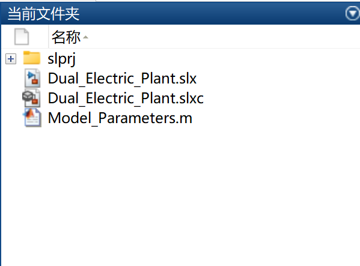
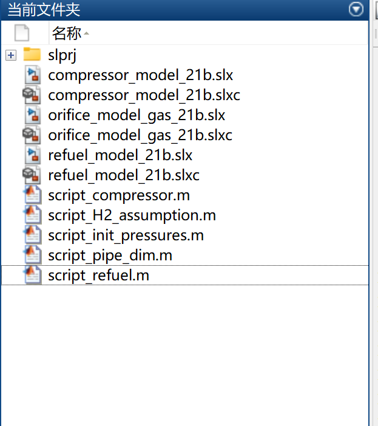
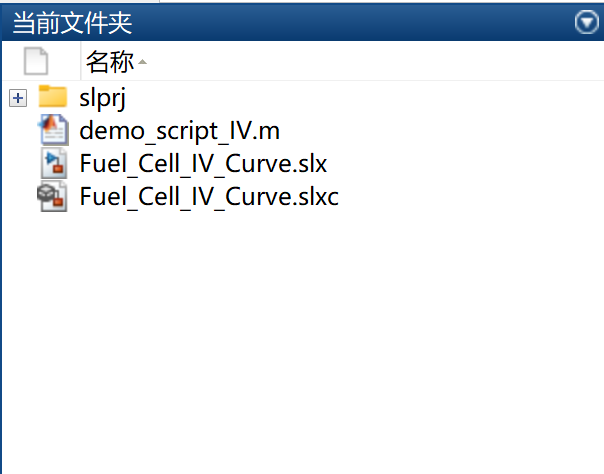

# Fuel Cell, Battery-Driven Motors and Hydrogen Transfer (Simulink Implementation)

Fuel Cell, Battery-Powered Motors, and Hydrogen Transfer (Simulink Implementation)

## Images

<!-- PAYMENT_BLOCK -->

## Get this dataset

- Payment link (Stripe): [Buy now](https://buy.stripe.com/3cs8yP7sY87d0vu9AB)
- Payment QR code: 

<!-- /PAYMENT_BLOCK -->
